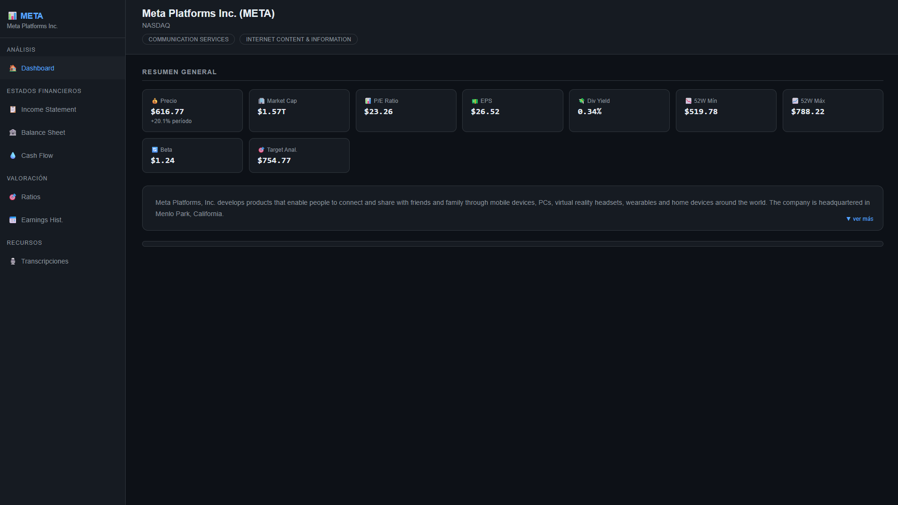

# Value-Investing-terminal

Automated Python financial terminal for quantitative analysis of Special Situations and Value Investing.
 Value Investing & Special Situations Terminal

Overview
An automated Python-based financial terminal designed to streamline due diligence for **Value Investing** and **Special Situations** (Spin-offs, M&A, Restructurings, and Share Buybacks). It fetches market data, computes financial ratios, and builds an interactive institutional HTML dashboard.

 Key Features
* **Multi-Source Ingestion:** Blends 10-year historical fundamental data via Alpha Vantage API with market price trends using `yfinance`.
* **Automated Dashboard Generation:** Converts raw financial data into a clean, local HTML dashboard opened automatically in your browser.
* **Structured Financial Analysis:**
  * Interactive Price Charts with flexible timeframes.
  * Core Financials (Income Statement, Balance Sheet, Cash Flow Statement).
  * Institutional Valuation Ratios.
  * Earnings Call Transcripts for qualitative & legal risk assessment.
* **Event-Driven Idea Generator:** A special-situations playbook, source-backed candidate form, and ranked watchlist with catalyst dates, scenario returns, and downside cases. The watchlist is saved locally in the browser.

The single-company dashboard's idea generator remains a manual research workflow, now alongside the live global event scanner in the integrated terminal's sidebar. The scanner discovers leads from market scanners, filings, and subscribed news. Verify each catalyst and primary source yourself; scores and analyst-entered estimates are not investment recommendations or forecasts.

 Tech Stack
* **Language:** Python 3.x
* **Financial Data:** `yfinance`, `alpha_vantage`
* **Data Processing & Visualization:** `pandas`, `plotly`, `HTML/CSS`

Architecture & Philosophy
Built around a quantitative investment framework to eliminate manual data collection and accelerate fundamental analysis. Designed for scalable data modeling and institutional-grade visualization.

 Quick Start
1. Clone this repository.
2. Install required packages: `pip install yfinance pandas numpy requests alpha_vantage plotly ib_async openpyxl`
3. If using the single-company Alpha Vantage data, set `ALPHAVANTAGE_API_KEY` in your environment.
4. Run `python terminal_pro.py`. Choose **1** for the integrated terminal (single-company analysis plus the live global event scanner in one sidebar/navigation), **2** for the scanner by itself, or **3** for a one-time IBKR scan/export.
5. In integrated mode, the terminal starts or reuses the local scanner service and embeds it as a full-height Global Event Scanner section alongside the company dashboard, financial statements, valuation, and research idea generator. The integrated process remains open to serve the scanner; close the terminal console to stop it. The scanner defaults to all sources and keeps public results if IBKR is unavailable. Configure provider credentials locally to enable optional vendor feeds; otherwise they are skipped with explicit warnings.

### Event-Driven Market Scan

The dashboard supports seven manually selected source modes: **IBKR Gateway**, **SEC EDGAR**, **Global regulators and exchanges**, **Online news + Tiingo/Benzinga + exchange RSS**, **Dow Jones Factiva**, **Public sources**, and **All sources**.

#### Global regulators and exchanges (free, no API keys)

`global_event_sources.py` reads primary-source publications directly. Public sources and All sources include all of them; SEC EDGAR mode adds the deal-form index.

| Source | What it surfaces |
|---|---|
| SEC EDGAR daily form index (last 3 business days) | Third-party and issuer tender offers (SC TO-T/TO-I, 14D-9), going-private (13E-3), merger proxies (PREM/DEFM14A/C), 425s, S-4/F-4, exchange-listed Form 10 spin-offs (10-12B), Schedule 13D, 25-NSE delistings and deregistrations. Fund and exchange filers are dropped; each filing is kept only for parties with a listed ticker, except pre-listing SpinCos. |
| [UK Takeover Panel disclosure table](https://www.thetakeoverpanel.org.uk/disclosure/disclosure-table) | Every UK company in an offer period, with offeror(s), offer-period start and Rule 2.6 "put up or shut up" deadline prefilled into the research row. |
| ASX market announcements | Takeovers, schemes of arrangement, asset acquisitions/disposals, demergers, buy-backs (not daily notices), capital returns, entitlement offers, halts, suspensions and administrations. |
| HKEXnews latest announcements (English) | Privatisations, general offers and Takeovers Code announcements, major and very substantial transactions, spin-offs, rights and open offers, halts, delistings and winding-up. |
| [Nasdaq trade halts](https://www.nasdaqtrader.com/trader.aspx?id=TradeHalts) | News-pending (T1–T3), corporate-action, additional-information and regulatory halts; volatility pauses are excluded. |

These are leads from regulator and exchange notices, not verified deal terms. A feed that fails or changes layout is reported in the warnings, and the rest of the scan continues. Japan (EDINET), Korea (DART) and Canada (SEDAR+) are not yet included: EDINET and DART need a free registration key, and SEDAR+ has no public API.

#### Deal calculator and SEC financials

Open any lead's research detail to find:

* **Deal calculator**: enter cash per share, stock ratio and acquirer price, a CVR estimate, an FX rate and days to close. Consideration value = (cash + ratio × acquirer price + CVR estimate) × FX; annualized = gross spread × 365 / days, the simple convention used in the special situations workbook. **Apply to workbook row** fills consideration value, gross spread, annualized and deal terms, plus the EV analysis upside and days.
* **Load SEC financials**: latest SEC XBRL facts for US filers (shares outstanding, cash, investments, debt, revenue, operating income, net income, operating cash flow and capex), with market cap, net cash, enterprise value, net cash per share, free cash flow and FCF yield derived from the scanner price. Each fact shows its period end, form and XBRL concept; facts more than two years older than the newest are treated as discontinued and omitted. **All sources** is the default: it scans IBKR and also runs SEC EDGAR and online/RSS news, retaining available results if IBKR or another provider is unavailable. Tiingo News ([API endpoint](https://api.tiingo.com/tiingo/news)) and the [Benzinga News API](https://docs.benzinga.com/api-reference/news-api/get-news-items.md) are included when their API keys are configured locally; without them, the public RSS feeds continue and the dashboard explains which optional feeds were skipped. Factiva is included when All sources is selected; it requires Dow Jones' [Factiva Retrieval API](https://github.com/dowjones/factiva-retrievalapi-demo), with API access and entitlements separate from an app.dowjones.com website login. Configure the API client ID, service-account username, and password in local environment variables before using Factiva. Factiva requests may count against account API usage or subscription limits. Each provider's coverage and issuer mapping remain subject to its own limitations.

The **Test GS Marquee connection** control separately verifies production Marquee OAuth access against `/v1/users/self`. It is an account connectivity check only: Marquee is not currently used for scanner leads or price enrichment. The check requests only the `read_user_profile` scope and does not display or store the API token or profile response.

SEC EDGAR mode searches recent event-related 8-K/6-K/10-K/10-Q filings and delisting-related Form 25/25-NSE/15 filings, mapping issuers to SEC's ticker directory when possible; it is not a complete market/security universe. Event matching includes delisting/listing-status warnings, symbol/name/CUSIP changes, insider-transaction language, and short-interest/positioning language. Online-news mode includes the [Nasdaq Trader corporate-actions RSS feed](https://www.nasdaqtrader.com/Rss.aspx?feed=currentheadlines&categorylist=105), general Google News RSS search, and Google News RSS searches scoped to OTC Markets and NYSE domains. Optional Tiingo and Benzinga news APIs augment these feeds when configured. In **All sources**, **Public sources**, and **Online news** modes, configured Benzinga/Quiver credentials also enable recent Form 4 insider leads; Benzinga adds FINRA-reported short-interest and fundamentals context for up to 50 discovered stock symbols per scan. These are credential- and entitlement-gated and report data only when the vendor returns it. Benzinga's FINRA-reported short-interest snapshots are periodic settlement-date data, not daily short-sale volume. The Quiver integration uses its documented live-insiders endpoint for recent transactions. No standalone FINRA API adapter for the LEAN `FINRAShortInterest` dataset or Brain filing-language metrics adapter is claimed: the LEAN examples are not direct endpoint specifications, and the public schemas/access for those feeds could not be verified. We could not verify a working official OTC Markets or NYSE event RSS endpoint (the NYSE RSS URLs tested returned 404), so the focused Google News RSS queries are fallbacks, not exchange-issued feeds. News cards show the company inferred from the headline when available, mark unresolved tickers as **Not verified**, and display the exact matched event categories and phrases. **Online-news tickers** are treated as verified only when they map uniquely to the SEC issuer directory and the headline's company name matches; otherwise the row remains a news lead and the generated `NEWS-*` value is shown only as a lead reference. Vendor-provided transaction symbols come from the corresponding data provider. Online headlines are secondary-source leads, so confirm reported events against issuer filings or other primary sources. Factiva search uses a recent date range and a fixed event-driven query; article tickers are only mapped when explicitly shown in the headline, and Factiva results are still leads for analyst verification. The scanner does not fabricate deal terms or valuation. SEC fair access requires an identifying User-Agent with contact details; configure `SEC_USER_AGENT` as described below.

Choose **2** for the loopback-only browser dashboard. It opens even if a selected source is unavailable and shows connection/request warnings with a retry button. Scans are manual; changing sources does not start automatic polling. The research tab follows the attached workbook's Special Situations and probability-weighted EV columns. Click a filtered name in the scanner feed to open its focused detail with editable fields from both workbook sections. When IBKR is selected and a usable quote is returned, Price uses a one-shot snapshot (last trade or bid/ask midpoint); capture time and source are recorded in Sources. Public sources do not provide an IBKR quote, so Price remains blank unless supplied by another quote source. Deal terms, counterparties, break cases, probabilities, and valuation fields remain analyst-research inputs. Edits are saved in that browser's local storage. **Export research workbook** downloads the research tabs with event matches, scanner contracts, and run summary; successful scans are archived in `reports\`.

Close the terminal running option 2 to stop the local dashboard. `IBKR_DASHBOARD_PORT` optionally changes its default local web port (`8765`). Refresh is manual by design.

Optional environment settings (defaults shown):

| Variable | Default | Purpose |
|---|---:|---|
| `IBKR_HOST` | `127.0.0.1` | Gateway/TWS host |
| `IBKR_PORT` | `4002` | IB Gateway paper port (`4001` for live; TWS commonly `7497`/`7496`) |
| `IBKR_CLIENT_ID` | `37` | API client ID; use a distinct ID for this app |
| `IBKR_MAX_SCANS` | `0` | Maximum scanner combinations per run; `0` requests every combination in IBKR's catalog |
| `IBKR_MAX_NEWS_CONTRACTS` | `150` | Maximum discovered contracts whose headlines are checked |
| `IBKR_NEWS_DAYS` | `7` | Headline lookback |
| `IBKR_NEWS_RESULTS_PER_CONTRACT` | `10` | Maximum headlines retrieved per contract |
| `IBKR_SCAN_SOURCE` | `all` | Initial dashboard source: `ibkr`, `sec`, `news`, `factiva`, `public`, or `all` |
| `SEC_USER_AGENT` | unset | SEC-compliant app identification and contact, e.g. `MyResearchApp/1.0 analyst@example.com`; also enables verified news ticker matching |
| `TIINGO_API_KEY` | unset | Optional Tiingo News API key |
| `BENZINGA_API_KEY` | unset | Optional Benzinga News, Form 4, FINRA-reported short-interest, and fundamentals endpoints (separate entitlements may apply) |
| `QUIVER_API_KEY` | unset | Optional Quiver live-insiders API token (endpoint requires the applicable plan) |
| `FACTIVA_CLIENTID` | unset | Dow Jones Factiva Retrieval API client ID |
| `FACTIVA_USERNAME` | unset | Dow Jones Factiva service-account username |
| `FACTIVA_PASSWORD` | unset | Dow Jones Factiva service-account password |
| `FACTIVA_METRICS_EMAIL` | `FACTIVA_USERNAME` | Optional email hashed for Factiva API usage metrics; the email itself is not sent in the metrics payload |
| `GS_MARQUEE_CLIENT_ID` | unset | Goldman Sachs Marquee client ID for the production connection check |
| `GS_MARQUEE_CLIENT_SECRET` | unset | Goldman Sachs Marquee client secret for the production connection check |

Set Tiingo, Benzinga, Quiver, Factiva, and Marquee credentials only in your local environment; do not put them in source code or send them in chat. Tiingo, Benzinga, and Quiver API keys are sent only in HTTPS Authorization headers to their documented endpoints, not in URLs. Factiva credentials are sent only to Dow Jones' HTTPS authentication endpoint and its bearer token only to the fixed Dow Jones Retrieval API endpoint. Marquee credentials are sent only to its production OAuth endpoint and its bearer token only to the fixed profile endpoint for the manual connection check. No IBKR username, password, or API key should be put in the code or report. IBKR authentication and data entitlements are managed by the local IB Gateway/TWS session.

   ---
##  Contact & Professional Profile
* **Developer:** Paul Barrera
* **Focus:** Quantitative Finance Tools, Financial Engineering & LegalTech, Regtech 
* **LinkedIn:** www.linkedin.com/in/paulbarrera1-25364b431
